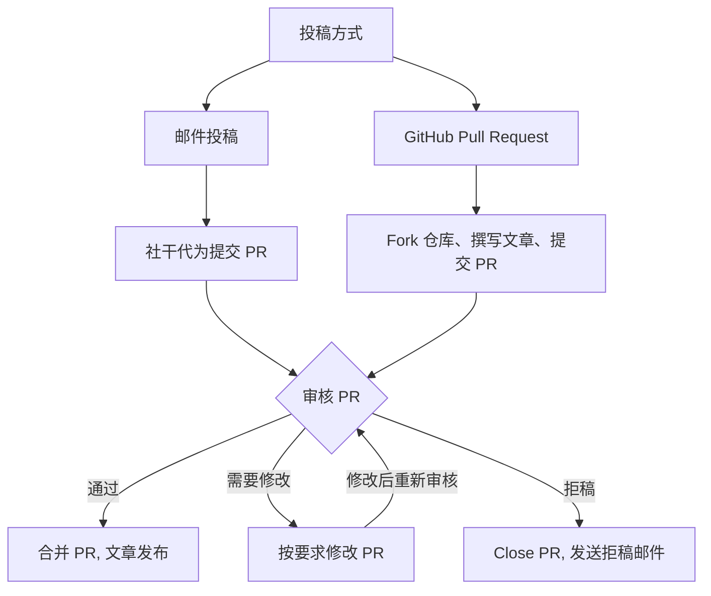

# 河源中学数学研究协会投稿指南

我们欢迎所有数学爱好者向我们投稿文章！
内容包括但不限于题目的分析求解、套题上传,
以及其他与数学相关的内容.

## 投稿流程

一般地, 投稿者需要先 fork 本仓库, 然后在自己的仓库中编写文章,
最后开启 Pull Request 向我们提交文章.

我们的社干会尽快审核并合并您的文章.

如果你不了解 Git 操作, 你也可以通过邮件将稿件发送至我们的 [邮箱](mailto:hyzxmath@outlook.com), 由社干代为提交.
在收到邮件后我们将尽快处理并发送回复邮件, 提交 PR 后我们会把对应的 PR 号发送至提交稿件的信箱, 之后的审核流程与正常 PR 相同.

> [!IMPORTANT]
> 投稿的审核工作完全由社干利用周末时间完成, 无法保证实时处理,
> 导致我们的审核周期比较长, 短则一两天, 长则甚至需要几周, 请耐心等待 awa



## 内容要求

1. 文章内容应该与数学相关
2. 文章内容应该为原创, 或者已经获得原作者授权
   - 转载的文章 ***必须*** 特别在 Markdown Front Matter 的 license 字段和 PR 描述内注明授权信息
3. 投稿文章 ***必须*** 放到 `content/external` 目录下

> [!IMPORTANT]
> 文章内容要保证合法合规, **不得包含任何政治敏感、色情暴力、反动等不当内容**, 违反上述要求的文章将被拒绝, 且提交者可能会被**永久**禁止投稿

## 风格指导

对所有的 Markdown 投稿, 都应该遵循下面的规范:

- **标题层级**: 文章内只使用 `##` 及以下层级, `#` 一级标题由 Front Matter 的 `title` 自动生成, **请勿在正文重复**.
- **数学公式**: 行内公式用 `$...$`, 独立公式用 `$$...$$`; 公式内避免使用中文标点.
- **图片**: 统一放在文章同目录下（如 `external/文章名/fig1.png`）, 引用时使用相对路径；每张图片必须填写 `alt` 替代文本.
- **代码块**: 须标注语言, 如 ` ```python `、` ```bash `.
- **引用**: 引用他人结论或数据时, 在 Front Matter 的 links 字段内给出可用的链接, 或在文末以链接形式列出出处.
- **语言**: 正文以中文为主；数学术语首次出现时建议附英文原名, 全文保持译名一致.
- **标点符号**: 全部使用英文半角标点, 不允许出现 `。` (中文句号, 易错认为下标) 等容易产生误解的符号

## Pull Request 要求

1. 一个 PR 一件事:
   - 如果是发布文章, 那么一个 PR 一篇文章
   - 如果是修改信息, 那你可以一个 PR 同时修改多篇文章
2. PR 标题需要有 `[Article]` 前缀
3. 仅接受 Markdown (.md) 文件.
4. ***必须*** 勾选 PR 模板中的复选框, 确认你的 PR 符合本贡献指南中的要求, 未勾选的 PR 不予合并

## Front Matter

模板见 [`archetypes/post.md`](archetypes/post.md)

如果你在本地或 CodeSpace 内安装了 hugo-extended 的话, 你可以直接使用

```shell
hugo new external/name/index.md
```

创建一个带有模板 Front Matter 的空白 Markdown 文件.

请按要求填写 Front Matter.

| 字段 | 必填 | 说明 |
| --- | --- | --- |
| `title` | 是 | 文章标题 |
| `date` | 是 | 发布日期, 格式 `YYYY-MM-DD` |
| `author` | 是 | 署名, 可以是真名或笔名 |
| `tags` | 否 | 标签数组, 如 `["函数", "不等式"]` |
| `categories` | 否 | 分类数组, 建议从已有分类中选择 |
| `license` | 否 | 授权或开源信息 |
| `draft` | 是 | 草稿标记, 投稿时应设为 `false` |

> [!IMPORTANT]
> license 字段留空, 将会自动填充 `All Right Reserved, 河源中学数学研究协会`

### 审核标准与反馈

- **审核维度**:
  1. 内容合规（无不当内容）；
  2. 数学内容正确；
  3. 格式符合本指南；
  4. 表述清晰可读
  满足以上四点即可能被合并, 不要求内容达到竞赛级难度.
- **反馈方式**: 审核意见将以 **PR 评论**形式给出；邮件投稿者会收到邮件回复.
- **修改流程**: 按评论修改后, 在 PR 中追加提交即可, 无需关闭重开；邮件投稿者直接回复邮件附上修改稿.

## 补充说明

### 本地写作环境

1. 安装 **Hugo Extended**（扩展版, 非扩展版无法编译 SCSS）及 **Git**.
2. 在 GitHub 上 [fork 本仓库](https://github.com/HZMath/HZMath.github.io/fork)
3. 克隆你的 fork 仓库并进入目录:

   ```bash
   git clone https://github.com/yournamne/HZMath.github.io.git
   cd HZMath.github.io
   ```

   有 GitHub CLI 的也可以用

   ```bash
   gh repo clone yourname/HZMath.github.io
   cd HZMath.github.io
   ```

4. 新建文章:

   ```bash
   hugo new external/你的文章名/index.md
   ```

5. 本地预览（默认地址 `http://localhost:1313`）:

   ```bash
   hugo server -D
   ```

6. 预览确认无误后再提交 PR. 若本地环境配置有困难, 可直接走邮件投稿路径.

### 社区行为准则

- 尊重每一位投稿者与审核者, 讨论对事不对人.
- 禁止人身攻击、歧视性言论、恶意刷屏或反复提交低质量内容.
- 对审核意见有异议时, 可在 PR 中理性说明理由, 由社干协商裁定.
- 违反行为准则者, 视情节给予提醒、拒稿或永久禁止投稿处理.

### 投稿前自查清单

- [ ] 文章主题与数学相关, 内容原创或已获授权
- [ ] 文件位于 `content/external/` 下, 格式为 `.md`
- [ ] Front Matter 字段完整, `draft` 已关闭
- [ ] 公式、图片、代码块符合格式规范
- [ ] PR 标题带 `[Article]` 前缀, 且一个 PR 只含一篇文章
- [ ] 已勾选 PR 模板中的全部复选框
- [ ] 转载文章已在 `license` 字段和 PR 描述中注明授权
